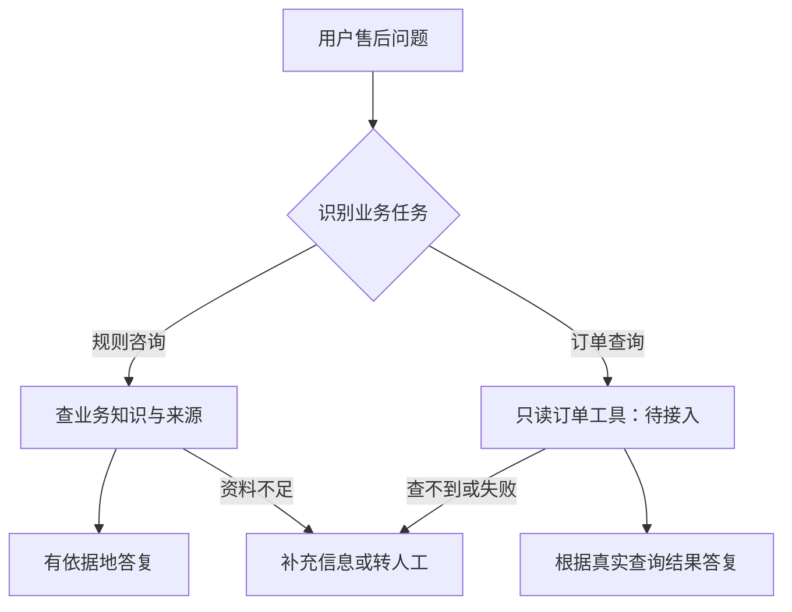

> 自拟售后场景示例。未连接真实接口，未执行真实客服任务；此文件是重新打包的示例。

## 关联需求

[[青禾家居售后客服—项目需求]]

## 业务目标

把规则咨询、订单查询和无法确认的问题分开处理。

## 正文

### 知识与来源

规则咨询读取 [[青禾家居—售后知识与口径]]。答复关联具体来源，资料缺失时说明尚未确认。

### 工具与接口

订单查询读取 [[青禾家居—订单查询工具说明]]。先取得订单号，完成归属和权限校验后再查询，只使用实际返回的字段。

### 任务流程

这是拟定流程图，订单工具尚未接入；图中的路径不是已执行的智能体记录。

1. 识别当前问题属于规则咨询还是订单查询。
2. 规则咨询查业务文档；订单问题查订单工具。
3. 资料缺失、查询失败或无法确认时转人工。

### 权限与异常处理

- 保留需求中的只读限制。
- 不自动退款，不修改订单。
- 不把知识文档中的通用口径当作订单的实时状态。

## 验收依据

[[青禾家居售后客服—验收清单]]

## 下一步

- [ ] 确认知识资料与转人工入口
- [ ] 接入订单系统并校验权限
- [ ] 执行清单中的用例，记录实际结果

当前是搭建方案草稿。业务场景自拟，智能体尚未在本库中运行。